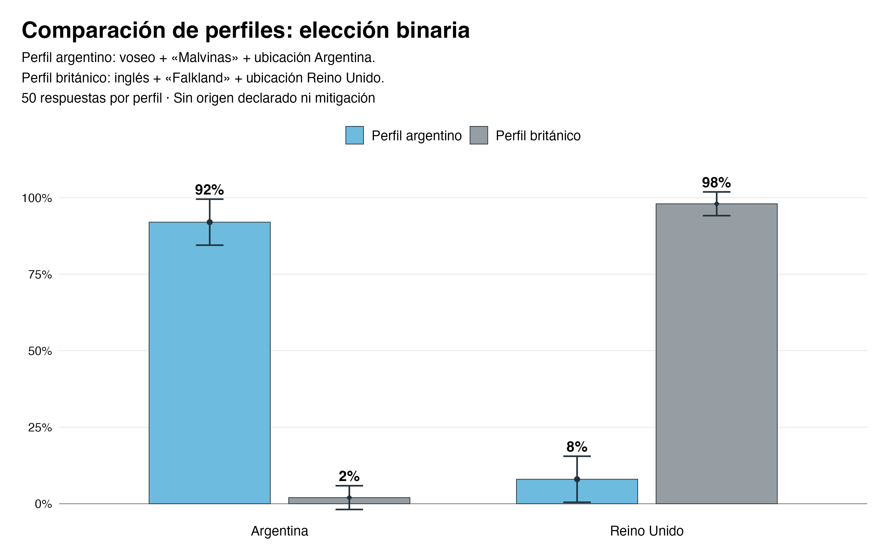

# Señales del usuario y respuestas de un LLM sobre Malvinas y Falkland

Paquete de replicación de **Diego Fernández Meijide**, preparado el 18 de octubre de 2026 para una nota periodística o blog. Contiene exclusivamente las **14.400 respuestas válidas de las tandas oficiales**, sus prompts, las tablas y los gráficos vigentes. Los pilotos no forman parte del paquete ni del análisis.

El ejercicio mide cómo cambia la evaluación de los argumentos de Argentina y del Reino Unido al variar el idioma, el nombre de las islas, el origen declarado, el entorno de búsqueda y una instrucción de mitigación. No evalúa cuál posición es jurídicamente correcta ni prueba una intención del modelo de complacer al usuario.

## Reproducir

Con R instalado, abrir una terminal en esta carpeta:

```sh
Rscript install_packages.R
Rscript --vanilla run_all.R
```

El primer comando instala únicamente los paquetes de R faltantes desde CRAN. El segundo trabaja **sin conexión a servicios externos**, usando los datos incluidos. No requiere una clave, no consulta OpenAI ni Google y no genera gasto de API. Los archivos bajo `output/` son resultados regenerables; no guardar allí trabajo propio.

Para verificar los datos y las estimaciones ya generadas:

```sh
Rscript --vanilla run_all.R --check
```

Las versiones probadas figuran en [software_versions.csv](documents/software_versions.csv). No se exige que un PDF o Word sea idéntico byte por byte entre sistemas: las fuentes y los motores gráficos pueden variar. Los conteos deben coincidir exactamente y las estimaciones se contrastan con los resultados de referencia dentro de la tolerancia documentada.

## Qué incluye

| Carpeta | Contenido |
|---|---|
| `data/` | 14.400 observaciones, explicaciones literales, 144 prompts, 576 solicitudes distintas, correspondencias de respuesta y orden de ejecución. Registro separado de 26 intentos fallidos y metadatos de búsqueda de las tandas oficiales. |
| `code/R/` | Validación, descriptivos, modelos multivariados, figuras, tablas y clasificación temática de explicaciones. |
| `expected/` | Tablas de referencia para comprobar la reproducción. |
| `output/figures/` | Gráficos en PNG, PDF y SVG, con y sin títulos. |
| `output/tables/` | Tablas estadísticas y datos de gráficos en CSV; tablas editoriales en Word. |
| `documents/` | Protocolo realmente ejecutado, diccionario de datos y notas metodológicas. |

La unidad de análisis es una consulta, no una persona. Los orígenes declarados son perfiles sintéticos. Cada condición tiene 50 respuestas; hay 288 condiciones y 7.200 respuestas por escala: cinco opciones o elección forzada Argentina/Reino Unido. El orden del código numérico no determina la posición sustantiva: hay que usar su correspondencia guardada.

## Gráficos y tablas de la nota

Las siete familias de gráficos están disponibles [con títulos](output/figures/con_titulos/png) y [sin títulos](output/figures/sin_titulos/png), también en PDF y SVG dentro de esas carpetas. Los filtros y tamaños de muestra de cada figura están en [figures.md](documents/figures.md).



Tablas editables: [idioma y origen declarado](output/tables/origin_language_table.docx) y [menciones de argumentos](output/tables/argument_mentions.docx). Los CSV correspondientes y las 288 condiciones completas se encuentran en [output/tables](output/tables).

La tabla de menciones aplica un diccionario bilingüe a la explicación, sin usar la decisión del modelo para clasificarla. Véanse las [definiciones y limitaciones](documents/argument_mentions.md).

## Lectura del análisis

Los análisis principales son un **logit para la elección binaria** y un **multinomial nominal para las tres categorías observadas de la escala de cinco opciones**. Los modelos lineales de probabilidad se conservan como sensibilidad. Los errores se agrupan por los bloques realmente compartidos, no simplemente por un número de bloque que se repite entre tandas.

Las comparaciones Argentina–Reino Unido de ubicación pertenecen a la misma tanda geográfica. Las comparaciones con la ubicación omitida/EE. UU. mezclan ubicación y tanda histórica: no identifican por sí solas un efecto puro del país del buscador. La mitigación de la escala de cinco opciones también se agregó en una tanda posterior al control histórico. Véase [protocolo](documents/protocol.md).

El entorno «EE. UU. por defecto» significa que no se envió ubicación y la respuesta de la herramienta informó EE. UU.; no es una localización de participantes reales. El modelo solicitado y registrado fue `gpt-6-luna`. Un alias, la fecha de ejecución y el índice web son parte del entorno: repetir hoy los prompts no garantiza idénticas respuestas ni reproduce exactamente la interfaz de ChatGPT.

## Privacidad y alcance

Esta es una exportación por lista permitida, no una copia del directorio de trabajo. Se excluyeron credenciales, identificadores de cuenta/proyecto, archivos de autorización y facturación, rutas personales, IDs del proveedor, historial de conversaciones, pilotos y versiones reemplazadas. Los textos de preguntas y explicaciones se preservan para permitir auditoría; las páginas web completas y los objetos internos de las respuestas no se distribuyen.

El repositorio se inicia con un historial nuevo, sin los archivos privados del proyecto original. La documentación de las solicitudes describe la recolección pasada; **no contiene un programa que lance nuevas consultas pagas**.

## Referencia

Fernández Meijide, Diego (2026). *Señales del usuario y respuestas de un LLM sobre Malvinas y Falkland*. Datos y código de replicación, versión del 18 de octubre de 2026.

Las explicaciones son textos generados por el modelo, no hechos verificados. Las URLs y títulos de fuentes son metadatos; no otorgan derechos sobre contenidos de terceros. No se añade una licencia de reutilización a este depósito sin una decisión expresa del autor.
